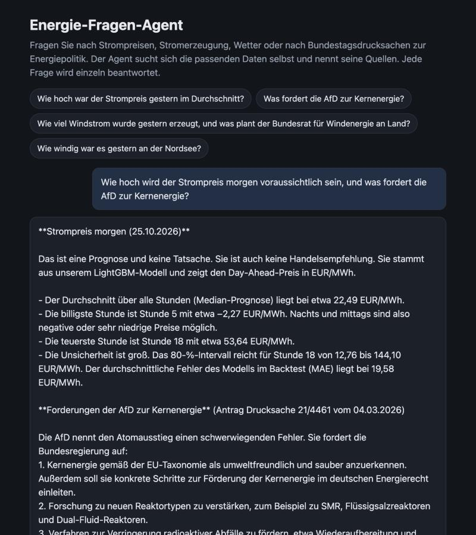

# German Energy Q&A Agent: LLM Tool Calling + RAG over Bundestag Papers


**Status: v0.2.** Runs locally and on Azure. Evaluated on 35 questions (numbers 100 % correct, 94 % of all answers fully correct).
The main open problem is retrieval for questions about a specific passage of a paper (see `eval/findings.md`).

**Live demo:** https://energiewende-agent.lemontree-ccdfb396.germanywestcentral.azurecontainerapps.io (German chat page; the access code is available on request)

An LLM agent that answers questions about the German energy system. It decides by itself whether a
question needs **live data** (electricity prices, power generation, weather), a **price forecast** for tomorrow
(from the model in [energy-price-forecast](https://github.com/Omercan4/energy-price-forecast)) or **documents**
(what the Bundestag decided or debated), calls the right tools, and answers with sources.



The project shows the full path from idea to service: tool calling with LangGraph, retrieval (RAG) with
LlamaIndex, a measured evaluation tracked in MLflow, Docker and CI, and a deployment on Azure.

## What it answers

Real answers (agent: `gemini-2.5-flash`, 2026-10-05):

| Question | Tools the agent chose | Answer (short) |
| --- | --- | --- |
| Wie hoch war der Strompreis gestern im Durchschnitt? | `price_series` | 168,29 EUR/MWh on 2026-10-04 (source: SMARD) |
| Was plant die Bundesregierung beim Wasserstoff-Hochlauf? | `bundestag_search` | Faster approval for hydrogen infrastructure, bundled in one law; cites Drucksachen 21/2506, 21/4326, 21/3203 |
| Wie viel Windstrom wurde letzte Woche erzeugt, und was sagt der Bundestag zum Ausbau der Windenergie? | `generation_load` (onshore, offshore), `bundestag_search` | 1,168,081 MWh onshore and 399,933 MWh offshore; a special tender for onshore wind (21/5920) and EU rules for offshore wind (21/1491) |

Questions outside the topic are declined ("Ich kann nur Fragen zur deutschen Energieversorgung beantworten.").

## How it works

```
client -> FastAPI (/ask) -> LangGraph agent (OpenAI-compatible LLM, tool calling)
            tools: price_series, generation_load, weather   -> SMARD / Open-Meteo (cached)
                   price_forecast                            -> forecast of tomorrow (JSON from the forecast project)
                   bundestag_search (party, paper type)      -> LlamaIndex retriever over Chroma, optional reranker
offline:    scripts/build_index.py builds the index -> data/chroma
tracking:   eval/run_eval.py logs evaluation runs to MLflow
```

- **The agent loop** (`src/energiewende/agent/graph.py`): the model picks tools, the tools run, the model reads
  the results, until it answers (at most 10 steps). Tool errors go back to the model instead of crashing.
- **Python computes, the LLM explains.** The data tools return mean, min, max and total, computed in code, with names that
  say what they are (`mean_per_hour`, `mean_total_per_complete_day`) and a `complete` flag per day, so a partial day (today)
  is never mistaken for a full one.
  In a first test the model averaged 24 hourly prices itself and was 7 % off (155.78 instead of 168.29).
  Since then every number in an answer comes straight from a tool.
- **Sources are collected by code**, not written by the model, so they cannot be invented.
- **Retrieval:** 99 Bundestag papers (Drucksachen) on energy topics from the current electoral period, split into
  chunks of 400 tokens and embedded locally with `intfloat/multilingual-e5-small`. Paper titles are kept as
  metadata but not embedded: they are often 900+ characters long and otherwise filled the chunks.

## Evaluation

30 hand-written questions (`eval/questions.yaml`): 10 number, 10 text and 10 mixed. Each answer is checked for:
the right **tools**, a **hit** (the gold paper is among the retrieved ones), the right **number** (computed by
calling the tool, accepting "168,29", "1.168 GWh" or "1,17 Mio. MWh"), and the **text**, graded by an LLM judge
(`claude-haiku-4.5`, another model family than the agent) against reference facts read in the papers.

| Run | Tools | Hit@k | Numbers | Text | All correct | Latency (ms) | Tokens |
| --- | --- | --- | --- | --- | --- | --- | --- |
| RAG off | 1.00 | - | 1.00 | 0.00 | 0.33 | 3047 | 1912 |
| k=4, chunk 400 | 0.97 | 0.75 | 1.00 | 0.70 | 0.80 | 4244 | 3710 |
| k=3, chunk 300 | 1.00 | 0.85 | 1.00 | 0.65 | 0.77 | 3926 | 3129 |
| k=6, chunk 300 | 0.97 | 0.90 | 1.00 | 0.75 | 0.83 | 4354 | 3906 |
| k=3, chunk 500 | 0.93 | 0.70 | 1.00 | 0.70 | 0.80 | 5519 | 3407 |
| k=6, chunk 500 | 0.97 | 0.85 | 1.00 | 0.80 | 0.87 | 6902 | 4681 |
| round 2: k=4, chunk 400 | 1.00 | 0.80 | 1.00 | 0.70 | 0.80 | 5204 | 3837 |
| round 2: k=6, chunk 300 | 1.00 | 1.00 | 1.00 | 0.75 | 0.83 | 4966 | 4083 |

What it shows (details in `eval/findings.md`):

- **Numbers are 100 % correct in all runs**: the "Python computes" rule works.
- **Without retrieval no text question is answered**; with it about 80 % of all answers are fully correct.
- **More context helps**: 6 passages beat 3; k=6 with chunk 500 is the most accurate, but also the slowest.
- **Round 2** fixed a failure pattern found in round 1 (the agent stopped halfway on two-part questions):
  tool accuracy went to 1.00. The overall score did not move, because the remaining errors come from
  **retrieval**: the search finds the right topic but the wrong party's paper, or the right paper but not the
  passage with the detail. That is the next thing to improve (a reranker, or filters on party and paper type).
- **The judge is noisy**: re-grading the same answers changed the text score by ±0.05, which is one question.
  Differences that small are not meaningful with 30 questions.

### v0.2 (24 Oct 2026)

Changes: `summarize()` names hourly and daily numbers explicitly, search filters (party, paper type), an optional reranker,
a `price_forecast` tool, 5 new questions. The gateway removed the old agent model, so the **agent is now
`claude-sonnet-5.5` and the judge `gemini-3.8-flash`** (another family than the agent). **These rows are not comparable
with the rows above.**

| Run (35 or 33 questions) | Tools | Hit@k | Numbers | Text | All correct | Tokens |
| --- | --- | --- | --- | --- | --- | --- |
| v3: baseline, k=6, chunk 300 (33 questions) | 1.00 | 1.00 | 1.00 | 0.95 | 0.97 | 10,573 |
| v3: + party / paper-type filters (33 questions) | 1.00 | 1.00 | 1.00 | 0.95 | 0.97 | 7,777 |
| v4: filters + forecast tool (35 questions) | 1.00 | 1.00 | 1.00 | 0.90 | 0.94 | 8,356 |

- **A scoring bug of mine:** negative prices written with a non-breaking hyphen ("‑0,24") were read as positive and marked
  wrong. Fixed with a test; all v3 and v4 runs use the fixed scoring.
- **The per-hour / per-day fix:** three questions (per hour, per day, total). Before the fix 2 of 3 were answered correctly
  (the per-day average could not be answered); after, 3 of 3 (`eval/bugfix/`).
- **Filters** gave the same accuracy with 26 % fewer tokens per question.
- **The question set is nearly saturated.** One question is 3 points, so 0.97 vs 0.94 is one question. The two misses in v4
  (m08, m09) are retrieval: the right paper is found, but not the passage with the detail.
- **Search alone, without an LLM** (`eval/retrieval_eval.py`, 20 questions, same numbers on every run):

  | | hit@1 | hit@3 | hit@6 | MRR |
  | --- | --- | --- | --- | --- |
  | vector search only | 0.45 | 0.70 | 0.85 | 0.570 |
  | + reranker (`mmarco-mMiniLMv2`, 30 candidates) | 0.55 | 0.70 | 0.80 | 0.635 |

  The reranker puts a gold paper first more often (+0.10 at rank 1), but loses one question at rank 6. With 20 questions
  that is not a significant difference, so it stays **optional and off by default**. A larger reranker (`bge-reranker-v2-m3`)
  was not tested.

## Limitations

- 99 papers of the 21st electoral period, only energy-related titles. No answers about other topics.
- The evaluation questions are written by me, and the judge is an LLM (noisy: about 1 question).
- The forecast tool depends on the forecast service being reachable (`FORECAST_URL`). It is a model forecast, not a fact.
- On Azure, the demo uses another model (`gpt-5-mini`) than the evaluation.

## Run it locally

Needs Python 3.12 and Docker.

```bash
python3.12 -m venv .venv
.venv/bin/pip install -r requirements-dev.txt
cp .env.example .env          # fill in DIP_API_KEY and the LLM settings
PYTHONPATH=src .venv/bin/python scripts/build_index.py   # downloads the papers, builds the index (~2 min)
docker compose up -d
```

- Chat page: http://localhost:8000 (without `APP_API_KEY` in `.env` it opens the chat directly)
- API for developers: http://localhost:8000/docs (`POST /ask` → *Try it out*)
- MLflow: http://localhost:5001, switch to **Model training** to see the evaluation runs
  (port 5000 is taken by AirPlay on macOS)
- Notebooks without Docker: `notebooks/ask.ipynb` (chat box), `notebooks/search.ipynb` (search only)
- Tests and lint: `.venv/bin/pytest -q` and `.venv/bin/ruff check .` (also run by GitHub Actions on every push)
- Evaluation: `PYTHONPATH=src .venv/bin/python eval/run_eval.py --k 6 --chunk-size 300`, then `eval/compare.py`

The LLM can be any OpenAI-compatible endpoint (`LLM_BASE_URL`, `LLM_API_KEY`, `LLM_MODEL`).
Optional: `FORECAST_URL` (where the price forecast is published) and `RERANKER_MODEL` (for example
`cross-encoder/mmarco-mMiniLMv2-L12-H384-v1`, about 470 MB).

## Deploy to Azure

Live: https://energiewende-agent.lemontree-ccdfb396.germanywestcentral.azurecontainerapps.io (API for developers: `/docs`).


`scripts/deploy_azure.sh` builds the image for `linux/amd64` with the search index inside (`Dockerfile.azure`),
pushes it to an Azure Container Registry, and creates or updates an Azure Container App. On Azure the agent uses
its own LLM, `gpt-5-mini` on Azure OpenAI; only the environment variables change, not the code.

- The app **scales to zero**: no costs while nobody uses it. The first request after a pause waits for the
  container to start (measured: 22 s); then a question takes about 6-17 s (`gpt-5-mini` is a reasoning model,
  slower than `gemini-2.5-flash` locally).
- `POST /ask` needs the header `X-API-Key` (set `AZURE_APP_API_KEY` in `.env`). The chat page asks for this
  *Zugangscode* first (checked by `GET /check-access`, no LLM call) and shows the chat only after a valid code;
  the browser remembers it. `/health` and `/docs` stay open.

## Data sources and licenses

| Data | Source | License |
| --- | --- | --- |
| Electricity prices, generation, consumption | Bundesnetzagentur \| SMARD.de | CC BY 4.0 |
| Weather (wind, solar radiation, temperature) | Open-Meteo.com, data from DWD | CC BY 4.0; the free API is for non-commercial use (this is a non-commercial portfolio project) |
| Bundestag printed papers (Drucksachen) | Deutscher Bundestag, DIP | Free of charge. Data from the DIP API may be used and processed in any form, as long as the source is named and changes are marked ([DIP terms of use](https://dip.bundestag.de/documents/nutzungsbedingungen_dip.pdf), 27 Feb 2023, rules 4b and 4c). Every citation names the *Bundestags-Drucksache* with its number and the source *Deutscher Bundestag/Bundesrat – DIP*. Search results are marked excerpts; answers are LLM summaries, not the original text. |

## Project layout

| Path | What it does |
| --- | --- |
| `src/energiewende/ingest/` | Clients for SMARD, Open-Meteo and the Bundestag DIP API, with an on-disk cache |
| `src/energiewende/index/` | Splitting, embedding, building and searching the Chroma index |
| `src/energiewende/agent/` | The tools and the LangGraph agent loop |
| `src/energiewende/api/` | FastAPI app (`/ask`, `/health`) and the chat page (`static/index.html`) |
| `src/energiewende/evaluation.py` | Scoring for the evaluation (number check, LLM judge, metrics) |
| `eval/` | Questions, run script, results and findings; `retrieval_eval.py` tests the search alone; `bugfix/` has before/after answers |
| `scripts/` | Build the index, ask from the command line, deploy to Azure |
| `notebooks/` | Small interfaces for searching and asking |
| `docs/superpowers/` | Design spec and the implementation plans (one per milestone) |
